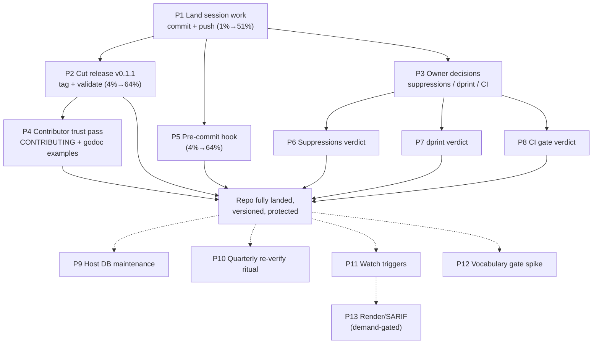

# Pareto Execution Plan — go-verdict — 2026-11-22 18:46

**Created:** 2026-11-22 18:46 · agent (Crush, glm-5.3) · backlog basis: TODO_LIST.md + ROADMAP.md (open questions) + docs/status/2026-11-22_16-24 and _18-12, all items verified still open at source (Step 0, pareto-planning skill)

**Goal:** land today's work, ship the release, and close every open loop — without Verschlimmbesserung: every change leaves the repo verifiably no worse than found (gates re-run after every mutation, gates re-run after every formatter).

## Step 0 — Errata (backlog corrections found while verifying)

- "Commit the session's work" is NARROWED: README.md already landed via owner commit `75da552` (license badge → Proprietary, matching the actual proprietary LICENSE; my Installation section was kept). Pending set was 8 files — now committed as `d76c2fd` + `d6bb0e9` before this plan (skill rule: commit pending work first).
- "Verify pkg.go.dev renders package docs" is RE-INFORMED by the owner verdict in `75da552`: pkg.go.dev license UNKNOWN is accurate and accepted; the remaining check is only that the module page and package docs appear after the next tag.
- All other backlog items verified open at source: CONTRIBUTING.md:17 still hand-runs golangci-lint; only tag is v0.1.0; zero `Example*` functions; no pre-commit hook; CHANGELOG `[Unreleased]` present.

## Pareto breakdown

| Tier                 | Tasks                                                                                                                                                         | Why this slice                                                                                                                                                                                                            |
| -------------------- | ------------------------------------------------------------------------------------------------------------------------------------------------------------- | ------------------------------------------------------------------------------------------------------------------------------------------------------------------------------------------------------------------------- |
| **1% → 51%**         | Land the session work: verify gates, commit in logical groups, push                                                                                           | Rescues ~6h of docs/lint/config work sitting exposed to the auto-commit daemon's known blind spot; nothing else is reviewable or durable until it is in git. Executed with this plan (`d76c2fd`, `d6bb0e9`, plan commit). |
| **4% → 64%**         | + Cut release v0.1.1 (fold `[Unreleased]`, tag, validate `go get`, check pkg.go.dev) and install the buildflow pre-commit hook                                | Turns the work into a versioned artifact consumers can pin, and closes the work-loss hole permanently for future sessions.                                                                                                |
| **20% → 80%**        | + Owner decision session (suppressions / dprint / CI) and execute each verdict; contributor trust pass (CONTRIBUTING alignment + godoc examples)              | Completes the trust surface: adopters get a tagged release with correct public docs; contributors get honest instructions and runnable examples; the three standing owner questions stop gating other work.               |
| **Other 20% → 100%** | Host DB maintenance, quarterly re-verify ritual, watch triggers (census, status index), FEATURES-vocabulary gate spike, demand-gated render/SARIF exploration | Hygiene and future-proofing: important, none of it blocking, several items conditional on demand signals.                                                                                                                 |

## Comprehensive plan (30–100 min tasks, ALL TODOs, sorted by importance / impact / effort / customer value)

| #   | Task                                                                                                                                                            | Tier      | Impact      | Effort | Customer value          | Est (min) |
| --- | --------------------------------------------------------------------------------------------------------------------------------------------------------------- | --------- | ----------- | ------ | ----------------------- | --------- |
| P1  | Land the session work: gates → 3 logical commits → push → verify remote tip                                                                                     | 1%→51%    | Critical    | S      | All (work becomes real) | 45        |
| P2  | Cut release v0.1.1: fold `[Unreleased]`, annotated tag, push tag, `go get` validation, pkg.go.dev presence check                                                | 4%→64%    | High        | S      | Adopters                | 60        |
| P3  | Owner decision session: suppressions, dprint plugins, CI workflow — present recommendations, record verdicts, close ROADMAP questions                           | 4%→64%    | High        | XS     | All (unblocks P6–P8)    | 30        |
| P4  | Contributor trust pass: align CONTRIBUTING.md with BuildFlow ownership + add godoc `ExampleVerdict`/`ExampleWorstOf`/`ExampleParse`                             | 20%→80%   | Med-High    | S      | Contributors            | 45        |
| P5  | Pre-commit protection: `buildflow precommit install`, test-fire on a scratch edit, document in AGENTS.md                                                        | 4%→64%    | Med-High    | XS     | Maintainers             | 30        |
| P6  | Execute suppressions verdict: keep-and-close, OR refactor `weight()` to named rank constants and drop the `mnd` entry (both gates re-run)                       | 20%→80%   | Medium      | S      | Maintainers             | 45        |
| P7  | Execute dprint verdict: wire local plugins (`BUILDFLOW_DPRINT_PLUGINS`) or accept-and-document the remote first-use fetch                                       | 20%→80%   | Medium      | S      | Maintainers             | 30        |
| P8  | CI gate: implement a GitHub Actions quality workflow, or document the local-only decision and close the ROADMAP question                                        | 20%→80%   | Medium      | M      | Adopters + maintainers  | 100       |
| P9  | Host maintenance: VACUUM buildflow state DB (1.09 GB), purge cache (0.60 GB), confirm SQLITE_BUSY gone                                                          | Other 20% | Med-Low     | S      | Maintainer (host)       | 30        |
| P10 | Quarterly ritual: re-verify consumer ledger at source repos (project-meta `1e35099`, BuildFlow `9a6af21`; both last verified 2026-11-22)                        | Other 20% | Low-Med     | XS     | Fleet                   | 30        |
| P11 | Watch triggers: define census re-run threshold and docs/status index threshold (≥3 reports) in ROADMAP                                                          | Other 20% | Low         | XS     | Fleet                   | 30        |
| P12 | FEATURES-vocabulary standing-gate spike: prototype a check that every FEATURES status comes from its own legend (the audit shipped a legend gap no gate caught) | Other 20% | Low         | M      | Maintainers             | 60        |
| P13 | Render/SARIF exploration — DEMAND-GATED: start only on a real consumer signal; guard: >200 LOC triggers the STACK re-derivation                                 | Other 20% | Conditional | L      | Future adopters         | 100       |

## Fine-grained breakdown (each ≤12 min, ALL TODOs, sorted by parent priority)

| #    | Subtask                                                                                                                                                  | Est (min) | Parent |
| ---- | -------------------------------------------------------------------------------------------------------------------------------------------------------- | --------- | ------ |
| 1.1  | `git status` + diff-sanity review of the pending set before staging                                                                                      | 6         | P1     |
| 1.2  | Stage + commit group A (.golangci.yml, AGENTS.md, STACK.md, TODO_LIST.md) with detailed message                                                          | 8         | P1     |
| 1.3  | Stage + commit group B (CHANGELOG, FEATURES, ROADMAP, DOMAIN_LANGUAGE, docs/status/) with detailed message                                               | 8         | P1     |
| 1.4  | Verify gates at each commit tip (docs-gates battery + buildflow lightning)                                                                               | 6         | P1     |
| 1.5  | Write this plan + stage + commit group C                                                                                                                 | 10        | P1     |
| 1.6  | `git push origin master`                                                                                                                                 | 3         | P1     |
| 1.7  | Verify remote tip (`git log origin/master -1`, `git status` clean)                                                                                       | 4         | P1     |
| 2.1  | Semver decision: docs-only since v0.1.0 → patch v0.1.1 (no API change)                                                                                   | 5         | P2     |
| 2.2  | Fold CHANGELOG `[Unreleased]` → `[v0.1.1] - <date>`                                                                                                      | 5         | P2     |
| 2.3  | Full pre-tag gate run: buildflow + docs-gates + `go test ./... -race`                                                                                    | 8         | P2     |
| 2.4  | Annotated tag `v0.1.1` with release message (go-release skill)                                                                                           | 5         | P2     |
| 2.5  | Commit CHANGELOG fold, push master + tag                                                                                                                 | 6         | P2     |
| 2.6  | `go get` validation in a temp module (resolves, builds, imports)                                                                                         | 10        | P2     |
| 2.7  | pkg.go.dev: module page present, docs rendered; license UNKNOWN expected (owner-verified accurate)                                                       | 8         | P2     |
| 2.8  | Record release in TODO (delete the row) + verify tag visible on GitHub                                                                                   | 4         | P2     |
| 3.1  | Present the 3 questions with recommendation + tradeoff each (suppressions: keep — the ranks are a table, not magic; dprint: local plugins; CI: workflow) | 8         | P3     |
| 3.2  | Record verdicts; route outcomes to TODO rows or closures                                                                                                 | 6         | P3     |
| 3.3  | Close ROADMAP Open-questions entries inline                                                                                                              | 5         | P3     |
| 4.1  | Rewrite CONTRIBUTING dev-setup section buildflow-first (drop hand-run golangci-lint)                                                                     | 10        | P4     |
| 4.2  | Add `ExampleVerdict` godoc example                                                                                                                       | 10        | P4     |
| 4.3  | Add `ExampleWorstOf` + `ExampleParse` godoc examples                                                                                                     | 10        | P4     |
| 4.4  | Gates re-run over new example code (lint: examples must satisfy the fleet config)                                                                        | 6         | P4     |
| 4.5  | Cross-check AGENTS/README claims still hold; commit                                                                                                      | 5         | P4     |
| 5.1  | `buildflow precommit install`                                                                                                                            | 4         | P5     |
| 5.2  | Test-fire: scratch edit → attempt commit → observe hook → restore file                                                                                   | 10        | P5     |
| 5.3  | Document the hook in AGENTS.md Commands                                                                                                                  | 5         | P5     |
| 5.4  | Verify hook + auto-commit daemon coexistence (no mangled dual commits)                                                                                   | 8         | P5     |
| 6.1  | (keep-branch) Confirm curated rows survive a fresh auto-configure; close rows with verdict                                                               | 10        | P6     |
| 6.2  | (refactor-branch) Define named rank constants for weight()                                                                                               | 8         | P6     |
| 6.3  | (refactor-branch) Rewrite weight() switch to named constants                                                                                             | 8         | P6     |
| 6.4  | (refactor-branch) Delete `verdict\.go` from mnd ignored-files                                                                                            | 3         | P6     |
| 6.5  | (refactor-branch) Full gates + tests; update AGENTS known-findings; commit                                                                               | 10        | P6     |
| 7.1  | (local-branch) Provision dprint plugins via `BUILDFLOW_DPRINT_PLUGINS`                                                                                   | 10        | P7     |
| 7.2  | (local-branch) Verify a cold offline run works                                                                                                           | 10        | P7     |
| 7.3  | (local-branch) Document in AGENTS; close rows                                                                                                            | 5         | P7     |
| 7.4  | (accept-branch) Document first-use fetch + cache location in AGENTS; close rows                                                                          | 8         | P7     |
| 8.1  | Decide CI content: buildflow in Actions vs plain `go test -race` + docs-gates                                                                            | 12        | P8     |
| 8.2  | Write `.github/workflows/quality.yml`                                                                                                                    | 12        | P8     |
| 8.3  | Verify the run on push; fix action quirks                                                                                                                | 10        | P8     |
| 8.4  | Document in AGENTS; close ROADMAP question; commit                                                                                                       | 8         | P8     |
| 8.5  | (decision-against-branch) Document local-only rationale in ROADMAP closure; commit                                                                       | 8         | P8     |
| 9.1  | `sqlite3 ~/.local/state/buildflow/buildflow.db VACUUM`                                                                                                   | 10        | P9     |
| 9.2  | Purge cache DB (doctor: safe to delete)                                                                                                                  | 5         | P9     |
| 9.3  | Re-run buildflow; confirm no SQLITE_BUSY                                                                                                                 | 8         | P9     |
| 9.4  | If contention persists: file buildflow issue (verify-before-filing at source)                                                                            | 10        | P9     |
| 10.1 | Set next quarterly re-verify date (2027-02-22) in TODO watch items                                                                                       | 5         | P10    |
| 10.2 | Re-verify consumer ledger rows at source repos; record evidence inline                                                                                   | 10        | P10    |
| 11.1 | Define census re-run trigger (e.g. consumer count ≥ 5) in ROADMAP                                                                                        | 6         | P11    |
| 11.2 | Define docs/status index threshold (≥3 reports) as watch note                                                                                            | 5         | P11    |
| 12.1 | Sketch the vocabulary check (statuses ⊆ legend set) as script or docs-gates idea                                                                         | 12        | P12    |
| 12.2 | Prototype against FEATURES.md; measure false positives                                                                                                   | 12        | P12    |
| 12.3 | Adopt in a gate or record deliberate non-adoption with rationale                                                                                         | 10        | P12    |
| 13.1 | (demand-gated) Collect real consumer demand evidence before any render/SARIF work; without it, do nothing                                                | 10        | P13    |

Total: 57 subtasks, ~7.5 h of bounded work; P1–P3 ≈ 2.25 h.

## Execution graph

## Verification protocol (the Verschlimmbesserung guard)

1. Gates run at every commit tip, and AGAIN after any formatter pass (formatter-order canon).
2. True exit codes captured directly, never through a pipe; summary line read in full.
3. No owner work reverted: `75da552` (badge, license stance) is accepted as-is; errata above record its effects.
4. Release only after full green: buildflow + docs-gates + `go test ./... -race`.
5. Every closed TODO row is deleted (not struck) per TODO_LIST canon; closures recorded in CHANGELOG at release time.
